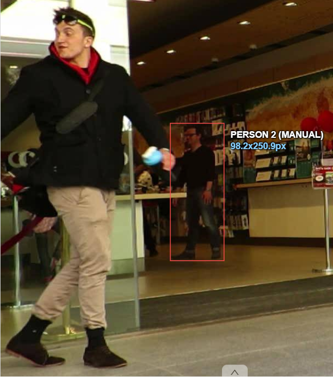
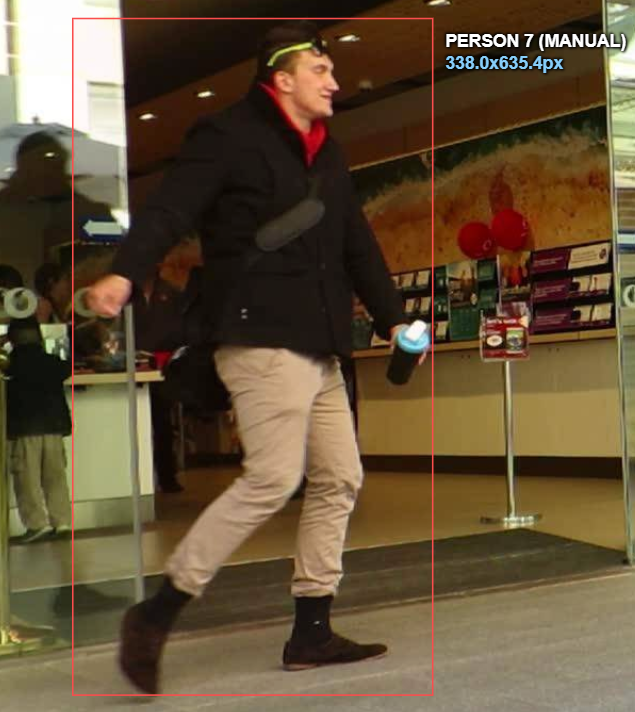
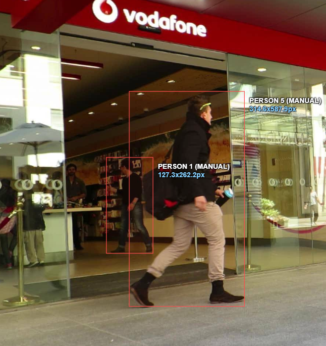

# Báo cáo cá nhân — HoVaTen-MSSV

Đổi tên file theo quy tắc `MSSV_HoTen.md`. Ví dụ: `20241234_NguyenVanAn.md`.

Đoạn video: MOT17-09, 150 frame (frame 1–150), nguồn MOTChallenge, giấy phép CC BY-NC-SA 3.0.

## 0. Thông tin học viên

- Họ tên: Trương Thành Đức
- MSSV: 2A202603034
- Mã đề (A/B/C): C
- Email:  26ai.ductt2@vinuni.edu.vn
- Link repository: https://github.com/thanhduc270998/K5-L2A-DAY05-TruongThanhDuc-2A202603034-MOTTracking.git
- Giờ bắt đầu: 16h20
- Giờ kết thúc: 18h36

## 1. Xem trước đoạn video (CP0)

Ghi **trước khi vẽ**, mỗi người một dòng.

| Mã | Frame xuất hiện | Frame cuối thấy được | Rẽ / dừng / đổi tốc độ ở frame | Bị che ở frame | Ghi chú |
|---|---|---|---|---|---|
| P1 | 0 | 150 | | 42 | |
| P2 | 61 | 150 | | | |
| P3 | 40 | 150 | | | |
| P4 | 2 | 106 | | 106 | |
| P5 | 28 | 136 | | 120 | |

## 2. Keyframe và thời gian (CP1, CP4)

Số keyframe lấy từ kết quả `src/check_submission.py`.

| Mã | Số keyframe | Keyframe ở frame | Số frame có mặt | Keyframe / 100 frame | Thời gian (phút) | Chỗ khó |
|---|---|---|---|---|---|---|
| P1 | 43 | 0, 2, 4, 5, 6, 7, 8, 9, 10, 11, 12, 13, 14, 15, 17, 20, 25, 28, 30, 52, 53, 55, 56, 57, 60, 61, 69, 70, 71, 72, 79, 82, 84, 87, 89, 92, 102, 112, 117, 122, 132, 142, 149 | 140 | 30.7 | | Đi sau cửa kính Vodafone ở đầu đoạn (0–20), bị P5 che một phần (`occluded`: 25–41, 52–54) và khuất hẳn (`outside`: 42–51), sau đó rẽ hướng tiến lại gần camera (92–149, chiều cao box tăng từ 250 lên 359 px). |
| P2 | 18 | 61, 62, 69, 79, 89, 99, 101, 109, 112, 114, 116, 117, 118, 119, 124, 129, 139, 149 | 89 | 20.2 | | Mới xuất hiện bị che một phần sau khung cửa kính và quầy trong Vodafone (`occluded`: 61–68), sau đó đổi hướng đi ra cửa tiến lại gần camera (101–149, chiều cao box tăng từ 231 lên 344 px). |
| P3 | 17 | 40, 49, 59, 69, 79, 89, 93, 99, 107, 109, 119, 123, 129, 131, 139, 145, 149 | 110 | 15.5 | | Đi vào từ mép phải khung hình (40–59) rồi đi nhanh tiến thẳng lại gần camera nên kích thước box tăng gần gấp đôi (chiều cao 484 lên 954 px), không bị che khuất. |
| P4 | 16 | 2, 3, 7, 8, 9, 11, 13, 15, 18, 20, 21, 25, 28, 31, 41, 90 | 104 | 15.4 | | Bước vào cửa hàng Woolworths (2–41) rồi đứng gần như yên cạnh em bé; bị che một phần (`occluded`: 25–27, 90–105) rồi khuất hẳn (`outside` từ 106). |
| P5 | 73 | 28, 37, 42, 44, 45, 46, 47, 48, 49, 50, 51, 52, 53, 54, 55, 56, 57, 59, 60, 61, 62, 64, 65, 66, 67, 68, 69, 70, 71, 72, 73, 74, 77, 78, 79, 80, 81, 82, 83, 84, 85, 86, 87, 88, 89, 90, 91, 92, 93, 94, 95, 97, 98, 99, 101, 102, 103, 104, 107, 108, 109, 110, 111, 112, 117, 128, 129, 130, 131, 132, 134, 135, 136 | 101 | 72.3 | | Di chuyển nhanh chéo ra xa camera (chiều cao giảm từ 670 xuống 350 px), dáng sải bước và vung tay làm bề rộng box đổi liên tục; cuối đoạn bị người đi đường che một phần (`occluded`: 109–119, 128–136) và khuất hẳn (`outside`: 120–127, 137+). |
| **Tổng** | **167** | - | **544** | **30.7** | | |

Keyframe / 100 frame của cả bài = tổng keyframe ÷ tổng số frame có mặt × 100 = 167 ÷ 544 × 100 = **30.7**

Bạn đặt keyframe nhiều nhất ở người nào? Vì sao (người đó rẽ, dừng, lại gần camera hay bị che)?

Đặt keyframe nhiều nhất ở **P5** (CVAT Track 4, MOT Track 3) với **73 keyframe / 101 frame có mặt = 72.3 keyframe / 100 frame** (mức này vượt ngưỡng cảnh báo `> 50` của `src/check_submission.py`). Lý do là P5 bước sải dài, vung tay và di chuyển nhanh theo hướng chéo ra xa camera từ trái sang phải rồi rẽ hướng vào cửa hàng Woolworths (chiều cao box giảm liên tục từ 670 px xuống 350 px, bề rộng thay đổi mạnh theo tư thế bước), nên quá trình gán đã chỉnh tay và cắm keyframe dày (gần như mỗi 1–2 frame ở đoạn 42–112) để giữ box bám sát người; đồng thời cần cắm keyframe liên tiếp quanh đoạn bị người đi bộ che một phần (`occluded`: 109–119, 128–136) trước và sau khi khuất hẳn (`outside`: 120–127). (Lưu ý: với đoạn đi chéo đều ở giữa 44–104 có thể giảm bớt keyframe, chỉ dồn vào chỗ đổi kích thước, rẽ hướng và quanh đoạn che để tránh vượt 50 KF/100 frame.)

## 3. Đoạn bị che (CP2)

Người bị che: `P1` (nam áo len đen, quần jean đi trong cửa hàng Vodafone — CVAT Track 0 / MOT Track 1)

| Mốc | Frame |
|---|---:|
| Bắt đầu bị che một phần (bật `occluded`) | 25 |
| Mất hẳn (bật `outside`) | 42 |
| Hiện lại (tắt `outside`) | 52 |
| Thấy rõ trở lại (tắt `occluded`) | 55 |

- Thời gian khuất hẳn: `10` frame = `0,33` giây (tính ở 30 fps, đoạn `outside` từ frame 42 đến 51).
- Quyết định: **giữ cùng ID** (không tạo track mới).
- Lý do (trả lời 3 câu: khuất bao lâu so với 60 frame, ngoại hình có khớp, chỗ hiện lại có đúng hướng và tốc độ):
  1. **Khuất bao lâu so với 60 frame:** P1 chỉ khuất hoàn toàn 10 frame (~0,33 giây), nhỏ hơn rất nhiều so với ngưỡng 60 frame (2 giây) của lớp.
  2. **Ngoại hình có khớp không:** Khớp hoàn toàn — vẫn là người đàn ông đeo kính, mặc áo len đen dài tay, quần jean xanh và giày tối màu đang đi bên trong cửa hàng Vodafone.
  3. **Chỗ hiện lại có đúng hướng và tốc độ không:** Đúng — trước khi bị P5 che (frame 0–41), P1 đi đều từ trái sang phải bên trong cửa hàng; khi lộ ra lại ở frame 52 phía sau lưng P5, P1 vẫn tiếp tục đi theo hướng từ trái sang phải với tốc độ ổn định, khớp quỹ đạo nội suy từ trước đoạn che. Trong hai đoạn che một phần (`occluded` ở 25–41 và 52–54), box vẫn ước lượng bao trọn toàn thân (amodal box) để không bị co giật.

Ảnh chụp màn hình:





*Nguồn ảnh nền: MOT17, MOTChallenge (Milan et al., 2016).*

## 4. Tự review ID (CP3)

Lượt 1 theo người (đi ngược từ frame 149 về 0 trên CVAT), lượt 2 theo cảnh (nhảy 10 frame). Ít nhất 3 dòng; không có lỗi thì ghi một dòng "đã kiểm hai lượt, không lỗi".

Loại lỗi dùng đúng một trong 7 mã: `id_switch`, `fragmentation`, `lost`, `merge`, `false_track`, `drift`, `flag`.

| Frame | Mã người | Loại lỗi | Mô tả một câu | Phát hiện ở lượt | Đã sửa? |
|---:|---|---|---|---|---|
| | | | | | |
| | | | | | |
| | | | | | |

Tổng hợp số lỗi theo loại:

| `id_switch` | `fragmentation` | `lost` | `merge` | `false_track` | `drift` | `flag` |
|---:|---:|---:|---:|---:|---:|---:|
| | | | | | | |

Lỗi nào chỉ lượt 2 (theo cảnh) mới thấy, lượt 1 (theo người) không thấy? Vì sao?

...

## 5. File xuất và kết quả tự kiểm (CP4)

| Kiểm tra | Kết quả |
|---|---|
| Tên file MOT 1.1 | TruongThanhDuc_mot.zip |
| Tên file CVAT for video 1.1 | TruongThanhDuc_cvat_video.zip |
| Số track ID khác nhau trong `gt/gt.txt` (phải là 5) | 5 |
| Frame `outside` không có dòng trong `gt.txt` (đúng / sai) | đúng |
| Job đã completed trên CVAT máy cá nhân | đã hoàn thành|

Dán phần tóm tắt in ra từ `src/check_submission.py`:

```text
Số frame in theo CVAT (bắt đầu từ 0). Trong gt.txt, frame_id = frame CVAT + 1.                                                                                   84, 87, 89, 92, 102, 112, 117, 122, 132, 142, 149]

=== File MOT 1.1: TruongThanhDuc_mot.zip ===
  Số track ID: 5   |   Tổng số box: 544
  [OK]        Đúng 5 track ID.

  Track | Frame có mặt | Số frame | Đoạn vắng (outside)       
      1 |   0–149      |      140 | 42–51
      2 |   2–105      |      104 | -                                                                                                                            73, 74, 77, 78, 79, 80, 81, 82, 83, 84, 85, 86, 87, 88, 89, 90, 91, 92, 93, 94, 95, 97, 98, 99, 101, 1
      3 |  28–136      |      101 | 120–127
      4 |  40–149      |      110 | -
      5 |  61–149      |       89 | -


=== File CVAT for video 1.1: TruongThanhDuc_cvat_video.zip ===

  Track | Nhãn   | Frame thấy | Keyframe | KF/100 frame | Frame occluded | Lần bật outside
      0 | person |        140 |       43 |         30.7 |             20 |               1
              Track 0: keyframe ở frame [0, 2, 4, 5, 6, 7, 8, 9, 10, 11, 12, 13, 14, 15, 17, 20, 25, 28, 30, 52, 53, 55, 56, 57, 60, 61, 69, 70, 71, 72, 79, 82, 
84, 87, 89, 92, 102, 112, 117, 122, 132, 142, 149]
      1 | person |         89 |       18 |         20.2 |              8 |               0
              Track 1: keyframe ở frame [61, 62, 69, 79, 89, 99, 101, 109, 112, 114, 116, 117, 118, 119, 124, 129, 139, 149]
      2 | person |        110 |       17 |         15.5 |              0 |               0
              Track 2: keyframe ở frame [40, 49, 59, 69, 79, 89, 93, 99, 107, 109, 119, 123, 129, 131, 139, 145, 149]
      3 | person |        104 |       16 |         15.4 |             19 |               1
              Track 3: keyframe ở frame [2, 3, 7, 8, 9, 11, 13, 15, 18, 20, 21, 25, 28, 31, 41, 90]
      4 | person |        101 |       73 |         72.3 |             20 |               2
              Track 4: keyframe ở frame [28, 37, 42, 44, 45, 46, 47, 48, 49, 50, 51, 52, 53, 54, 55, 56, 57, 59, 60, 61, 62, 64, 65, 66, 67, 68, 69, 70, 71, 72, 
73, 74, 77, 78, 79, 80, 81, 82, 83, 84, 85, 86, 87, 88, 89, 90, 91, 92, 93, 94, 95, 97, 98, 99, 101, 102, 103, 104, 107, 108, 109, 110, 111, 112, 117, 128, 129, 
130, 131, 132, 134, 135, 136]
  [CẢNH BÁO]  Track 4: 72 keyframe / 100 frame > 50. Quá dày, dồn keyframe vào chỗ rẽ / dừng / bị che.

  Tổng: 167 keyframe / 544 frame có mặt = 30.7 keyframe / 100 frame
  [OK]        Đọc được 5 track từ annotations.xml.

=== Tóm tắt ===
  Lỗi: 0   |   Cảnh báo: 1
  Không có lỗi định dạng. Mở CVAT xem lại từng [CẢNH BÁO]; cảnh báo đúng ý bạn thì ghi lý do vào báo cáo.
```

## 6. Ba câu kết

1. Nếu được gán lại, bạn sẽ đặt keyframe khác ở đâu? Vì sao?

   ...

2. Có chỗ nào bạn không chắc "cùng ID hay ID mới"? Bạn đã quyết định và ghi chú thế nào?

   ...

3. Một lỗi ID trong job của bạn (nếu không còn sót, chọn lỗi đã sửa) có thể làm xe tự lái dự đoán sai chuyển động của người đó như thế nào? Lỗi đó ảnh hưởng MOTA hay IDF1 nhiều hơn?

   ...

## Bonus (nếu làm)

### B1 — Hai người đi sát

...

### B2 — So cách đặt keyframe

| Cách đặt | Số keyframe | Frame trôi nhất | Ghi chú |
|---|---:|---:|---|
| Đều mỗi 30 frame | | | |
| Theo chỗ đổi hướng | | | |

...

### B3 — So với tracker có sẵn

| Frame | Mã người | Tracker làm gì | Nhãn của bạn | Giải thích (đoán rồi sửa / ghép IoU / box score thấp / ngoại hình) |
|---:|---|---|---|---|
| | | | | |
| | | | | |

## 7. Tài liệu tham khảo và công cụ AI đã dùng

...
